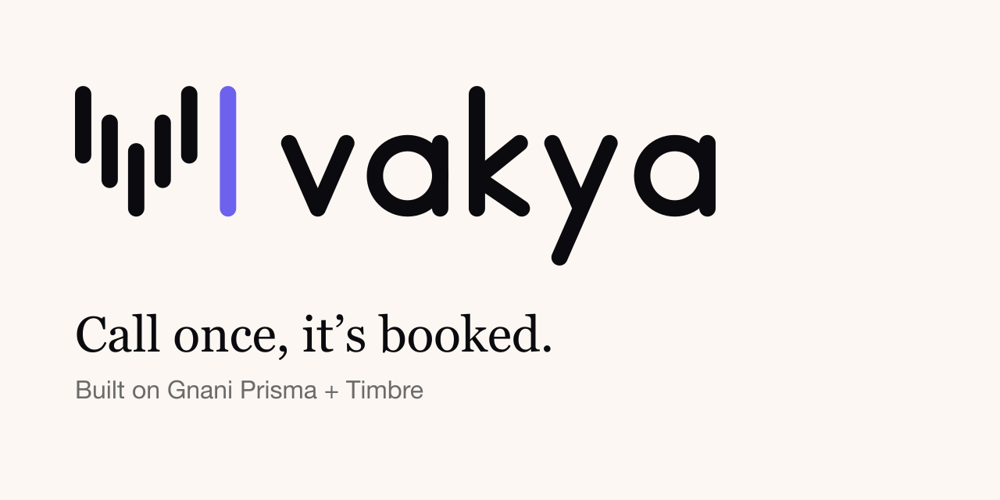
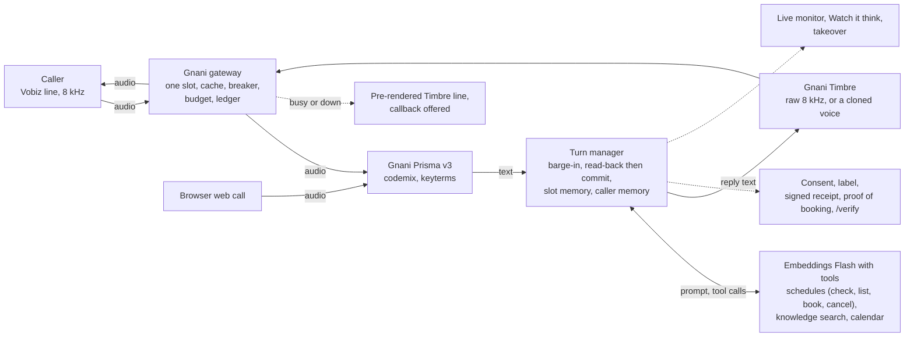

<p align="center">
  
</p>

# Vakya: call once, it's booked

**A phone front desk for Indian small businesses. It answers in Hindi, Marathi and English, checks the schedule for a free time, reads every number and date back, and books only after the caller says yes.**

Entry for Gnani AI's *Great Indian AI Internship Challenge*. Speech by **Gnani Prisma, Timbre and voice cloning** · replies by **Embeddings Flash** · telephony by **Vobiz** · Hindi, Marathi, English and code-mixed speech over 8 kHz phone audio.

| Deliverable | Link |
| --- | --- |
| Live demo | Coming |
| 60-second video | Coming |
| LinkedIn post | Coming |
| X post | Coming |
| Repository | This repository |

**Honest status:** the Gnani integration is written and tested against fakes. It has not yet been run against the live API, so nothing on this page is a Gnani measurement. See [Measured results](#measured-results) and [Limitations](#limitations).

---

## The problem

- Small clinics, hotels, salons and offices in India miss calls. The front desk is busy with the person in front of them, so the phone rings out.
- Callers do not speak one language. A Marathi caller says "appointment" in English and the day in Marathi, in the same sentence.
- Phone audio is bad. It is 8 kHz, band-limited, often from a street, and a recogniser that is fine on clean audio drops digits and days.
- A booking built on a misheard digit is worse than no booking: the patient never gets the reminder.

## What Vakya does

A caller rings the business's number, or gives a missed call and Vakya rings back. The agent speaks first, says it is an AI, answers from the business's own documents and books through the schedule.

- **Generic front desks for eight trades.** Clinic, hotel, salon, restaurant, office, institute, service centre and gym. The owner picks a type from an illustrated gallery, types the organisation's name, and gets the agent together with its default schedule. No business name is invented for the owner.
- **Visual schedules with exact availability and nearest alternatives.** A week calendar (a month grid of rooms left for hotels) where a drag blocks a range, and a one-page schedule form that also reads "Mon to Sat 10 to 1 and 5 to 9, Sunday closed" in English, Hindi and Marathi. Whether a time is free is decided by one deterministic engine, not by the model, and the calendar, the "Ask like a caller" tester, a staff booking and the agent on the phone all use it. When a time is taken, outside the hours or not where a slot starts, it returns the reason and the nearest free times either side. Details: [`docs/SCHEDULES.md`](docs/SCHEDULES.md).
- **Read-back, then commit.** Day, date, time and phone number are said aloud. The booking tool answers "not done" until the agent has read them back and the caller has said yes, and a corrected digit is read back again.
- **Missed-call callback on Vobiz.** A missed call to the business's missed-call number should not cost it a customer, so the front desk rings back. The number's Answer URL is a signed link that rejects the call unanswered (never answered, never billed), and Vakya places the call 8 seconds later, once per number per 10 minutes, at most 10 calls an hour, and only to allowed numbers when a list is set. Built and tested with fakes; not yet tried on a live Vobiz number. See [`docs/PHONE.md`](docs/PHONE.md).
- **Caller memory, mapped to the number.** A returning caller is greeted by name in their language ("Namaste Sunita ji, pichli baar aapne Mangalvaar 4 baje ki appointment li thi"). The profile is keyed by the phone number and holds the name, language, the people booked for, the trade's usual details, the last booking and follow-up notes. It never holds ID numbers, card numbers, OTPs or health conditions, expires after a retention period, and the caller can say "forget me". See [`docs/CALLER_MEMORY.md`](docs/CALLER_MEMORY.md).
- **"Running late" and tokens by phone.** The receptionist taps "Running 40 min late" once. Callers who ask "how many patients before me?" hear their token, how many are ahead and about when to come ("आपका टोकन 3 है; आपसे पहले 2 मरीज़ हैं…"), and the desk sees the later patients whose time moved by 15 minutes or more, with "Call to let them know" on each. [`docs/RUNNING_LATE.md`](docs/RUNNING_LATE.md).
- **One number, the whole family.** A son books for his mother; next time the agent asks "Is this for Sunita ji again, or for someone else?". Each number keeps the people it books for, with their relation and usual details, and the bookings list says who booked for whom. Those names are passed to Gnani Prisma's `speaker_names` so they come back spelled right. [`docs/CALLER_MEMORY.md`](docs/CALLER_MEMORY.md).
- **Ears that learn.** When Prisma mishears a name, the owner taps "Misheard?" on that line once; it becomes one of the desk's ten Prisma substitution rules and a key term. Before each caller turn Vakya also tells Prisma what is coming (a name, a day or time, digits, or a yes or no) through `topic` and key terms, and the live view shows "Listening for: a name (Sunita, Rahul)". The fields were accepted on Gnani's live API on 5 Nov (a substitution rule, key terms, and speaker names each fixed how Prisma spelled "Vakya" on one clip); not yet tried on a real call. [`docs/HEARING.md`](docs/HEARING.md).
- **Watch it think.** The live call is a split screen: on the left what is being said, every word tinted by its script and language, with a chip for each thing the agent checks or does; on the right the front desk's schedule reacting to it, and what Vakya remembers about the caller. A staff member can take the call over.
- **Proof of booking, with sealed receipts.** When the agent books, it keeps the caller's utterance behind each field, its own read-back and the caller's yes, hashes each, and seals them under one signed Ed25519 receipt. Anyone can check the receipt at `/verify` or offline with [`sdk/verify`](sdk/verify). Changing one byte of a clip or one letter of a transcript breaks it. Public views redact the name and number. Format: [`docs/RECEIPT_SPEC.md`](docs/RECEIPT_SPEC.md).
- **Caller Theatre.** Ten synthetic callers phone a front desk (a son booking again for his mother, an elderly Marathi caller, a rushed Hinglish caller, street noise, one wrong digit, a full slot, a cancellation, a returning caller, a request to note an ID number, a two-night hotel stay) and the score comes from what ended up in the booking system, not from how the call sounded. Failures are shown as plainly as passes. [`docs/THEATRE.md`](docs/THEATRE.md).
- **A cost meter and the Gnani gateway.** *Production numbers, not claims:* every Gnani request goes through one gateway that allows one active request at a time (a Gnani account answers 429 to a second), serves repeats from a cache, opens a circuit breaker after repeated failures, keeps a share of the credit budget in reserve for live calls, and writes one line per request to a usage ledger. The desk shows estimated credits per call and per booking, labelled as estimates until the rates are measured on our account. [`docs/GNANI.md`](docs/GNANI.md).
- **When Gnani is busy or down there is no second speech model.** The caller hears a short Timbre line rendered ahead of time ("one moment" or "I will call you back") and is offered a callback or a person.
- **A browser web call** (a link or a QR code) to try it without a phone, and a bookings list that syncs to Google Calendar when one is connected (tested with fakes).

A short example, written by us (invented clinic, invented number, not a recording):

> **Agent:** गुरुवार, ५ नोव्हेंबर, संध्याकाळी ५:३०, फोन नंबर ९८७६५ ४३२१९. बरोबर आहे का? *(Thursday 5 November, 5:30 pm, phone 98765 43219. Is that right?)*
> **Caller:** नाही, शेवटचा अंक नऊ नाही, शून्य आहे. *(No, the last digit is not nine, it is zero.)*
> **Agent:** माफ करा. फोन नंबर ९८७६५ ४३२१०. आता बरोबर आहे का? *(Sorry. Phone 98765 43210. Is that right now?)*
> **Caller:** हो, बरोबर. *(Yes, correct.)*

## How Gnani's models are used

| Model | Endpoint | Format in Vakya | Where in the code |
| --- | --- | --- | --- |
| **Prisma v3** (speech to text) | `POST /stt/v3`; realtime `wss://api.vachana.ai/stt/v3/stream` | `format=codemix` (English stays in Latin script), `language_code` from the agent's languages (or `indic-auto`), `keyterms` from the business's documents and staff names, `previous_text` from the caller's last turn. REST per utterance today; the 8 kHz socket is not yet on the phone path | [`backend/services/gnani_client.py`](backend/services/gnani_client.py), [`gnani.py`](backend/services/gnani.py), [`asr.py`](backend/services/asr.py) |
| **Timbre** (text to speech) | `POST /api/v1/tts/inference` | Raw PCM16 at 8 kHz for the phone line, played as it is with no resampling; 24 kHz WAV for the browser | [`backend/services/gnani.py`](backend/services/gnani.py), [`routers/phone.py`](backend/routers/phone.py) |
| **Voice cloning** | `POST /api/v1/tts/voice-clone/embeddings`, then Timbre with `model: vachana-vc-v1` and `speaker_embedding` | The consented recording becomes a 768-number embedding, stored sealed with the voice | [`gnani_client.py`](backend/services/gnani_client.py) (`clone_embedding`), [`voice_vault.py`](backend/services/voice_vault.py) |

**Status:** all three are covered by tests against fakes and none has been run against the live API. [`docs/GNANI.md`](docs/GNANI.md) lists exactly what is guessed. The first thing to do with a key is `backend/bench/gnani_smoke.py`.

**What reasons, honestly:** the model that decides what to say and which tool to call is **Embeddings Flash** (Google, hosted), not a Gnani model. Document search uses Embeddings embeddings, with keyword search as the backup. The caller's words and the passages of the business's documents a turn needs reach Google when it answers. Gnani does the speech; Embeddings does the thinking.

## Architecture



The long version is [`docs/ARCHITECTURE.md`](docs/ARCHITECTURE.md).

## Measured results

Only what has been measured is here.

- **Caller Theatre, scripted run: 9 of 9 scenarios passed, 41 of 41 booking fields correct.** This is a **scripted** run: the model step was a deterministic stand-in rather than Embeddings Flash, and the input was typed text, so speech recognition, the caller voices and the line noise were not exercised. It shows the tools, the schedule rules and the read-back work end to end; it says nothing about what a language model does with the same calls, and its latency is not meaningful (the stand-in answers instantly, so no timing is reported). One run per scenario (20261104-052003), made before the tenth scenario was added. [`docs/THEATRE.md`](docs/THEATRE.md).
- **Everything else is pending on Gnani.** The acoustic-stress report card (the same 24 invented booking calls clean, over an 8 kHz line, through street noise at 10, 5 and 0 dB and through G.711, with and without keyterms, scored on whether the name, day and time came through) shows "Gnani Prisma run pending" and an empty table at `/report-card`. Prisma and Timbre latency and credits per call are likewise unmeasured. Nothing from an earlier stack is carried over. [`docs/STRESS_REPORT.md`](docs/STRESS_REPORT.md), [`docs/RESULTS.md`](docs/RESULTS.md).

Reproduce the report card once a key is set: `./vakya stress --conditions all --provider gnani --keyterms`.

## Trust and safety

- **Disclosure.** Every call opens with a spoken statement that it is an AI.
- **Consent.** A cloned voice needs a ticked consent statement (or, in strict mode, a one-time spoken sentence with a random code). The record is stored with the voice; withdrawing consent deletes both. See [`docs/VOICE_VAULT.md`](docs/VOICE_VAULT.md).
- **Receipt, manifest and label.** An Ed25519 signed receipt, a C2PA content manifest and an AI-generated file label on every clip, and a Proof of booking for every booking; anyone can check a clip at `/verify` or offline with [`sdk/verify`](sdk/verify). Limits of the claim: [`docs/REVOCABLE_PROVENANCE.md`](docs/REVOCABLE_PROVENANCE.md).
- **Callers can be forgotten.** A returning caller's profile is kept only to serve their next call, expires after `CALLER_PROFILE_RETENTION_DAYS`, and can be deleted by number. It holds the caller's number, so treat the store as personal data.
- **A person can step in.** Staff can watch a live call and take it over; the agent can ask for a person but never chooses the number it transfers to.
- **Data leaves the machine only through the services you key in.** Gnani receives the audio of a call and the text it speaks, Google receives the text of a turn and the document passages it needs, Vobiz carries the call.
- **Synthetic data only.** No real caller, number or recording is used anywhere in this repository. The legal notes here are design choices, not legal advice.

## Quickstart

```bash
git clone https://github.com/ayushcody/vakya.git && cd vakya
./vakya setup                                   # checks Python 3.10+ and Node 20+; builds backend/.venv, installs the web app
printf 'GNANI_API_KEY=...\nEMBEDDINGS_API_KEY=...\n' >> backend/.env
./vakya start                                   # API on :8020, web app on :3010, phone-only port on :8021
open http://localhost:3010/desk/try             # make a web call and correct a digit on purpose
```

`./vakya warm` before a demo checks the keys and prepares the held lines, `./vakya doctor` checks the machine and the running app, `./vakya test` runs the test suites and `./vakya stress` runs the report card. On Windows use `vakya.ps1` (untested). Nothing is downloaded: every model is a hosted service. For containers on any host, see [`deploy/README.md`](deploy/README.md).

## Configuration

Everything lives in `backend/.env`; [`backend/.env.example`](backend/.env.example) documents the settings and the root [`.env.example`](.env.example) lists the ones containers need. The ones that matter:

| Setting | Purpose | Without it |
| --- | --- | --- |
| `GNANI_API_KEY` | Gnani Prisma, Timbre and cloning (header `X-API-Key-ID`) | Nothing can hear or speak |
| `GNANI_STT_MODEL`, `GNANI_STT_FORMAT`, `GNANI_VOICES`, `GNANI_KEYTERMS` | Prisma model and output format (`codemix` by default), Timbre voice names, extra keyterms. See [`docs/GNANI.md`](docs/GNANI.md) | Defaults |
| `GNANI_CREDIT_BUDGET`, `GNANI_CREDIT_RESERVE_PCT` | The credit budget and the share kept for live calls | 5000 and 20 |
| `EMBEDDINGS_API_KEY` | Embeddings Flash for replies and Embeddings embeddings for document search | No replies; search falls back to keywords |
| `EMBEDDINGS_API_KEYS` | Extra Embeddings keys (other Google accounts), separated by commas, spaces or new lines. When one key hits its quota or is invalid, the next takes over at once | Only `EMBEDDINGS_API_KEY` is used |
| `VOBIZ_AUTH_ID`, `VOBIZ_AUTH_TOKEN`, `VOBIZ_CALLER_ID` | Real phone calls. `./vakya start` opens a tunnel to the phone-only port 8021 | The browser web call still works |
| `GOOGLE_CALENDAR_ID`, `GOOGLE_SERVICE_ACCOUNT_FILE` | Sync bookings to a Google Calendar | Bookings stay in Vakya's own list |
| `CONSENT_MODE` | `tick` (default) or `strict` | n/a |
| `CALLER_PROFILES`, `CALLER_PROFILE_RETENTION_DAYS` | Remember returning callers, and for how long | n/a |
| `TOOLS_READBACK` | Read back, then commit only on a yes (default on) | n/a |

## Repository map

| Path | What is in it |
| --- | --- |
| `backend/` | FastAPI app: `routers/` (phone, web call, conversations, callers, consent, verify, schedules, bookings, templates, usage), `services/` (`gnani*`, `llm`, `retrieval`, `tools`, `availability`, `schedules`, `hours_parser`, `schedule_tools`, `booking_evidence`, `provenance`, `caller_memory`, `telephony/`), `templates/agents/` (the eight front desks), `bench/` (report card, Caller Theatre), `tests/` |
| `frontend/` | Next.js app: the public site (`src/app/(site)`), the desk (`src/app/(app)/desk`), `/verify`, the report card |
| `docs/` | [`ARCHITECTURE`](docs/ARCHITECTURE.md), [`GNANI`](docs/GNANI.md), [`PHONE`](docs/PHONE.md), [`WEB_CALL`](docs/WEB_CALL.md), [`SCHEDULES`](docs/SCHEDULES.md), [`CALLER_MEMORY`](docs/CALLER_MEMORY.md), [`THEATRE`](docs/THEATRE.md), [`STRESS_REPORT`](docs/STRESS_REPORT.md), [`RESULTS`](docs/RESULTS.md), [`RECEIPT_SPEC`](docs/RECEIPT_SPEC.md), [`VOICE_VAULT`](docs/VOICE_VAULT.md), [`SUBMISSION`](docs/SUBMISSION.md), [`DEPLOY_DEMO`](docs/DEPLOY_DEMO.md) |
| `sdk/verify/` | Offline receipt checker (Python and Node) |
| `deploy/` | A provider-neutral container deployment guide |
| `vakya`, `vakya.ps1` | One script to set up, start, check and test |

The facts the website quotes live in one file, [`frontend/src/components/site/submissionData.ts`](frontend/src/components/site/submissionData.ts); the report card reads [`reportCardResults.json`](frontend/src/components/report/reportCardResults.json).

## Limitations

- **Gnani models not yet run live.** Integrated and tested against fakes; the report card is empty until Prisma has been run.
- **Synthetic audio, simulated noise.** The report card will show where the cliff is, not what a real caller will score. Repeat it on real recordings.
- **Caller Theatre ran on a scripted model, text only.** The audio run and a Embeddings Flash run are pending.
- **Digits are the hard part.** Whether Prisma hears a ten-digit phone number whole is not measured; hence the read-back.
- **Reasoning is not Gnani's.** Embeddings Flash, hosted by Google. A Google key and Google's rate limits are in the path of every reply.
- **No second speech model.** If Gnani is out of credits, rate-limited or down, a live caller gets a held line and a callback offer, not an answer.
- **Missed-call callback, inbound calls on your own number and Google Calendar sync are untested live.** The call logic ran on an earlier trial line; the Vobiz adapter and the callback are tested with fakes.
- **The agent's scheduling tools have only been tested with a scripted model.** The availability engine is deterministic and tested directly; a real model choosing when to check, offer and book has not been exercised on a real call.
- **The hours reader is rules first.** It covers the English, Hindi and Marathi phrases it knows, flags guesses and lists what it did not understand.
- **Tested on one machine:** an Apple M4 with 16 GB. Windows and Linux are untested.
- **Not legal advice.** Consent, labels and deletion follow the direction of India's rules on synthetic media and personal data; check what is lawful for your use.

## Team

| Name | Role |
| --- | --- |
| Ayush Chougula | Phone pipeline, schedules, Gnani integration, this site |
| Teammate (TBC) | Role to be confirmed |

## Licence

The Vakya source code is released under the [MIT Licence](LICENSE). Educational and research project, not affiliated with Gnani AI. Gnani Prisma, Timbre and voice cloning are used through Gnani's API under Gnani's terms with your own key; Embeddings is used through Google's API under Google's terms; telephony is Vobiz's.
