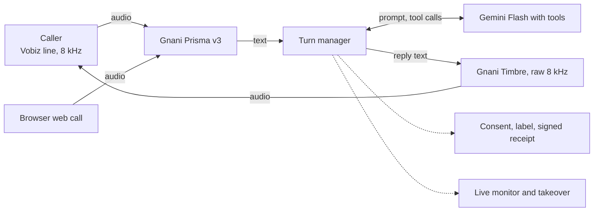

# Architecture

How one call moves through Vakya, stage by stage, and where each stage lives in the code. Status labels: **built** runs today, **integrated** is written and tested against fakes only, **being wired** is in progress. Nothing here has run against a real business: all calls, callers and numbers are synthetic.

## The stages

| Stage | What happens | Status | Code |
| --- | --- | --- | --- |
| **Line** | Vobiz opens a WebSocket to the phone-only public port (8021) and streams 8 kHz mu-law audio, after fetching an answer document (VobizXML with a `<Stream>`) from a signed link on the same port; for outbound calls Vakya asks Vobiz to ring the number first. A missed call reaches Vakya as the Answer URL of a missed-call number, which rejects the call unanswered, and the front desk rings the caller back (see the callback section below). A browser web call joins at the same turn manager over its own WebSocket. | built (call logic ran live on an earlier trial line; the Vobiz adapter, inbound and the missed-call callback are tested with fakes, not yet on a live Vobiz number) | `backend/routers/phone.py`, `backend/phone_public.py`, `backend/routers/web_call.py`, `backend/services/telephony/` |
| **Prisma v3** | Turns the caller's utterance into text. `format=codemix` keeps English words in Latin script; `keyterms` come from the business's documents (names, services) and `previous_text` from the caller's last turn; `language_code` is the agent's languages or `indic-auto`. Today each utterance goes over REST (`POST /stt/v3`); the realtime socket (`wss://api.vachana.ai/stt/v3/stream`, 1,024-byte frames at 8 kHz) exists as `StreamingRecognizer` and is being wired onto the phone path. There is no second recogniser: when Gnani is busy or down the gateway answers with a held line (see below). | integrated, being wired | `backend/services/gnani_client.py`, `backend/services/gnani.py`, `backend/services/gnani_gateway.py` |
| **Turn manager** | Decides when the caller has finished (barge-in, an early speculative reply after 250 ms of silence whose audio waits for the full 500 ms pause, a longer wait of 1.1 s after the agent asked for a number or date), keeps a per-call form of what the caller said (name, phone, day, time), greets a returning caller from their profile, detects voicemail, and enforces **read-back then commit**: a booking tool first answers "not done" with the resolved day, date and time, the agent reads them aloud, and the tool runs only after a spoken yes. | built | `backend/services/turn_taking.py`, `caller_memory.py`, `caller_profiles.py`, `spoken_digits.py`, `voicemail.py`, `call_control.py`, `tools.py` (`TOOLS_READBACK`) |
| **Gemini Flash with tools** | Gemini Flash (Google, hosted) writes the reply from the business's documents (search by Gemini embeddings with keyword search as the backup, structure-aware passages, a question index) and calls tools: the schedule tools (`check_availability`, `list_free_slots`, `book`, `cancel`, `find_booking`; see "Schedules and availability" below), knowledge search, end call, transfer. Each booking is stored in the appointments store and, when a calendar is connected, synced to Google Calendar. Gnani does not provide this stage. | built (calendar sync tested against fakes; not yet run with a live Gemini key on a real call) | `backend/services/llm.py`, `retrieval.py`, `grounding.py`, `backend/mcp_servers/appointments.py`, `services/gcal.py` |
| **Timbre** | Speaks the reply. `POST /api/v1/tts/inference` returns raw PCM16 at 8 kHz for the phone (no resampling) or a 24 kHz WAV for the browser. Numbers and dates are written so the voice reads them the way an Indian caller expects. With a consented voice, the call uses `model: vachana-vc-v1` and a stored `speaker_embedding`. If Gnani cannot answer (credits, rate limit, an outage), the caller hears a short Timbre line rendered ahead of time and is offered a callback or a person. | integrated | `backend/services/gnani.py`, `speech_numbers.py`, `gnani_hold_lines.py` |

## Side rails

- **Consent, label, receipt.** Around every clip: a consent record before a voice is cloned (tick by default, strict spoken-code mode available), an AI-generated file label with a C2PA content manifest, and an Ed25519 signed receipt that `/verify` or `sdk/verify` can check. Cloned voices and their Gnani embeddings are sealed in the voice vault and deleted on withdrawal. Code: `services/provenance.py`, `consent_record.py`, `voice_vault.py`, `routers/consent.py`, `routers/verify.py`. Format and limits: `docs/RECEIPT_SPEC.md`, `docs/VOICE_VAULT.md`, `docs/REVOCABLE_PROVENANCE.md`.
- **Live monitor and takeover.** The desk shows a live call's transcript; staff can take it over. The agent may ask for a person but never picks the number it transfers to (`PHONE_TRANSFER_MODE`, default callback). Code: `services/call_control.py`, `frontend/src/app/(app)/desk/calls/`.
- **Caller memory.** A returning caller's name, language, last booking and follow-up notes are kept per number, expire after `CALLER_PROFILE_RETENTION_DAYS` and can be deleted by number. Code: `services/caller_profiles.py`, `routers/callers.py`.

## Missed-call callback

A missed call to the business's missed-call number should not cost it a customer, so the front desk rings back. **Built and tested with fakes; not yet tried on a live Vobiz number.**

- The owner asks for a link: `POST /api/phone/missed-call-link {agent_id}` returns a signed URL `/api/phone/missed-call/{token}` (valid 365 days; the token names the agent and the owner and opens nothing else). In the Vobiz console it is the Answer URL (POST) of an XML Application the missed-call number is attached to; it answers `<Response><Hangup reason="rejected"/></Response>`, so the call is never answered or billed.
- The route is served on the phone-only port (8021), answers 200 at once, and places the call `MISSED_CALL_DELAY_S` (default 8) later through the same outbound path as a call from the desk. It respects `PHONE_ALLOWED_NUMBERS`, calls a number back once per `MISSED_CALL_DEDUPE_S` (default 600), never while a call with that number is live, and at most 10 calls an hour per owner. `MISSED_CALL_CALLBACK=off` turns it off.
- `GET /api/phone/missed-calls` lists the events (received, skipped with a reason, called back, failed; numbers masked). The desk shows the link and the last 10 events under Front desk, Phone number, and badges a callback "Called back" on the Calls page. Code: `services/missed_calls.py`, `routers/phone.py`. Details: `docs/PHONE.md`.

## Front desks, schedules and availability

An agent is a **front desk** of one of eight types (`clinic`, `hotel`, `salon`, `restaurant`, `office`, `institute`, `service_centre`, `fitness`; templates in `backend/templates/agents/`, the stored `template_id` says which). Creating one from a template (`POST /api/agents/from-template`) also creates its default **schedules**. The contract and every rule are in [`SCHEDULES.md`](SCHEDULES.md); in short:

- **A schedule** is a name, a kind (time slots, or nightly stays for hotels), the opening hours of each weekday as ranges (a break is a gap between ranges), a slot length, a gap between bookings, a capacity (bookings at once, or rooms), a minimum notice, how far ahead callers may book and holiday dates. Staff **blocks** (a drag on the calendar) mark ranges busy. Code: `services/schedules.py`, `routers/schedules.py`.
- **The availability engine** (`services/availability.py`) is the only place that decides whether a time is free. It builds the slots of a day, gives each a status (past, blocked, full, partly booked, free), and answers a request with a reason (`closed`, `full`, `blocked`, `past`, `outside_hours`, `too_soon`, `too_far`, `not_a_start`, `unclear`), the nearest free slot before and after (same day first, then day by day to the horizon) and a sentence in English and Hindi. It is plain code with no model in it, so the same answer reaches the calendar, the "Ask like a caller" tester, a staff booking and the phone agent. A request can be given as words ("is Thursday 6 pm free", "kal shaam 6 baje"), resolved by `services/when.py`.
- **Writing a booking** (`services/schedule_bookings.py`) re-checks the slot inside the store's lock, so two callers cannot take the same one, and syncs to Google Calendar as before.
- **The agent's tools** (`services/schedule_tools.py`, bound to the front desk on the call): `check_availability`, `list_free_slots`, `book`, `cancel` and `find_booking`, all answered by the engine. Every template's instructions carry the rule: never say a time is free without checking, offer the nearest times when it is not, read the day, date and time back and book only after a spoken yes; the turn loop enforces the read-back and a confirmation before a cancel. Status: **built; tested through the turn loop with a scripted model, not yet with a real model on a real call.**
- **Opening hours from words** (`services/hours_parser.py`): a deterministic reader for English, Hindi and Marathi phrases ("Mon to Sat 10 to 1 and 5 to 9, Sunday closed", "सोमवार से शनिवार सुबह 10 से 2"), run before any model; a model is asked only when the parser understood nothing, and its answer goes through the same validation. The desk shows the result for review and never saves it by itself.
- **The screens** (`frontend/src/app/(app)/desk/bookings/`, `components/schedules/`): schedule cards, a week calendar with click and drag to block, a month grid for nights, the tester, and the step-by-step schedule form with a live preview.

## Bookings

The desk's Bookings page reads real appointments, not call transcripts.

- `GET /api/bookings?from=&to=&agent_id=` lists appointments whose start date is from..to (YYYY-MM-DD, both optional), soonest first. A row has `id`, `name`, `phone` (last four digits only), `service` (the schedule's name, or a doctor for the older tool), `reason`, `start` (ISO 8601 in `VAKYA_TIMEZONE`, default Asia/Kolkata), `status` (`booked` or `cancelled`), `conversation_id` and `receipt_id` (null when not made on a call), `agent_id`, `created_at`, `calendar_sync`, and for schedule bookings `schedule_id`, `schedule_name`, `end`, `nights`, `party` and `note`. `GET /api/bookings` also takes `schedule_id=`.
- `DELETE /api/bookings/{id}` cancels one, and removes it from the calendar when it was synced.
- The store is the JSON file the agent's schedule tools (and the older appointments tool) write (`VAKYA_APPOINTMENTS_FILE`); the booking is made only after the caller's spoken yes (read-back first). Code: `routers/bookings.py`, `services/schedule_bookings.py`, `mcp_servers/appointments.py`.
- **Google Calendar sync** (`services/gcal.py`): with `GOOGLE_CALENDAR_ID` and a service-account key (`backend/data/google_calendar.json`, or `GOOGLE_SERVICE_ACCOUNT_FILE`) the tool checks when the calendar is busy and creates or deletes an event. `calendar_sync` is `synced`, `pending`, `failed` or `not_configured`; a calendar failure never blocks a booking. Tested with fakes, never against a real calendar.

## Live call events

Every turn of a call (browser web call, the owner's own turns, the phone call) appends small structured events to an in-memory log per front desk (`backend/services/call_events.py`, the latest 600 per desk, `CALL_EVENTS=off` disables it). The desk's live screen (`frontend/src/components/live/`) and the phone monitor read them; nothing here is stored for good.

- `GET /api/agents/{agent_id}/live-events?after=<seq>&conversation_id=&follow=` is a `text/event-stream` (owner only): events after `seq`, then new ones; `GET /api/conversations/{id}/events?after=` returns the same as JSON `{events, last_seq}` for a poller. In Python: `call_events.since / wait_for / subscribe`.
- Every event has `seq` (ever increasing), `at` (UTC), `type`, `agent_id`, `conversation_id`, `turn_id`. Phone numbers appear as the last four digits only; a number the caller spoke is masked in the transcript.

| `type` | Extra fields |
| --- | --- |
| `caller` | `text`, `typed`, `language` (`en`, `hi`, `mr`, `hinglish`, ...), `script` (`latin`, `devanagari`, `mixed`, `other`), `unsure` (true when the language cannot be told: Devanagari with no Hindi or Marathi function word, or a low-confidence recognition), `words` (`[[word, "en" \| "hi" \| "mr" \| "x"], ...]`, `x` = not claimed). Sent once the conversation is known, before any tool runs. |
| `tool` | `tool` (`check_availability`, `list_free_slots`, `book`, `cancel`, `find_booking`, `queue_status`), `call_id`, `phase` (`start` when it begins, `end` with its result), `status` (`checking`, `free`, `taken`, `listing`, `listed`, `booking`, `readback`, `booked`, `refused`, `cancelling`, `confirm`, `cancelled`, `finding`, `found`, `failed`), `schedule_id`, `schedule`, `date`, `time`, `label` (one line to show as it is, e.g. "Checked Thu 5 Nov 6 pm: taken, offered 5:30 pm or 6:30 pm"). `check_availability` end: `available`, `reason`, `before`, `after`, `options` (`[{date, time}]`). `list_free_slots`: `free` (times), `count`. `book`: `readback` = the tool refused until the caller says yes (the agent reads the slot back), `booked` has `booking_id`, `refused` has `options`. `cancel`: `confirm` = waiting for the yes. `find_booking`: `count`, `bookings`. |
| `agent` | One spoken sentence, when its audio is ready: `index`, `text`, `audio_ms`, `readback` (it is part of the read-back before a booking or cancel), `disclosure` (the AI disclosure), `language`, `script`, `words`. |
| `booking` | A booking was made and its evidence sealed: `booking_id`, `name` (owner only), `schedule_id`, `schedule`, `date`, `time`, `start`, `evidence_id`, `receipt_id`, `evidence_complete`. |
| `hearing` | What Prisma was told to listen for and what it probably corrected (`services/hearing.py`, `docs/HEARING.md`): `kind` (`listening`: `expecting`, `kinds`, `names`; or a correction: `heard`, `meant`, `rule_id`, `probable`), `label` (one line to show as it is, e.g. "Listening for: a name (Sunita, Rahul)"). |
| `turn_end` | `language`, `tool_calls`, `fallback`, `interrupted`, or `error` (a code). |

Order inside a turn: `caller`, then for each tool `tool` start and end, then the `agent` sentences, then `booking` (when one was made), then `turn_end`.

## Proof of booking, Caller Theatre and the cost meter

- **Proof of booking** (`services/booking_evidence.py`): when the agent books, the caller's utterance behind each field, the agent's read-back and the caller's yes are kept, hashed and sealed under one signed receipt of kind `booking`, which `/verify` and `sdk/verify` can check. Clips are deleted after `BOOKING_EVIDENCE_RETENTION_DAYS`; the hashes stay.
- **Caller Theatre** (`backend/bench/theatre/`, `docs/THEATRE.md`): ten scripted synthetic callers phone a front desk and are scored from what ended up in the booking system. Run so far with a scripted model, text only.
- **Gnani gateway and cost meter** (`services/gnani_gateway.py`, `usage_ledger.py`, `docs/GNANI.md`): every Gnani request goes through one door with one slot, a cache, a breaker, a credit budget and a ledger; the desk shows estimated credits per call and per booking.

## What each key switches on

| Key | Effect |
| --- | --- |
| `GNANI_API_KEY` | Prisma, Timbre and cloning. Without it nothing can hear or speak. |
| `GEMINI_API_KEY` | The reply model (Gemini Flash) and the embeddings for document search. Without the embeddings, keyword search answers; without the key there are no replies. |
| `VOBIZ_*` | Real phone calls. Without them the browser web call still works. |
| `GOOGLE_CALENDAR_ID` and a service account file | Calendar sync. Without them bookings stay in Vakya's own list. |

## Where data lives

Local mode keeps everything under `backend/data/` (git-ignored, files mode 0600 where they hold personal data): agents, documents, call records, caller profiles, voices and receipts. The sealed voice files are encrypted at rest. A hosted mode with Supabase exists and is tested against fakes only.

## What this architecture does not do

It does not run Gnani's Evon (weights only), does not use Gnani's agent builder (out of scope for the challenge), has no government API, and has not served a real caller. The measured behaviour of the recognition stage is the acoustic-stress report card (`docs/STRESS_REPORT.md`), which is pending a run on Gnani Prisma.
